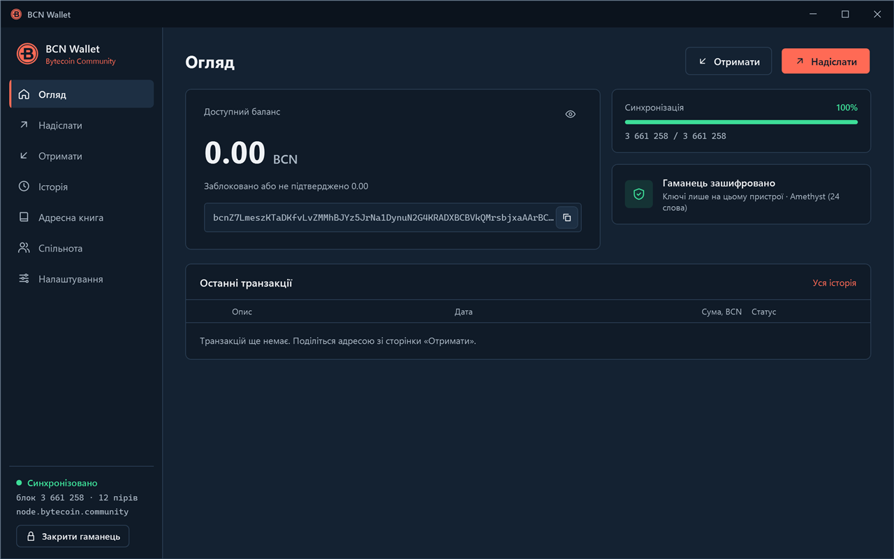

# BCN Wallet untuk Windows

[English](README.md) · [Українська](README.uk.md) · [Español](README.es.md) · [Português](README.pt.md) · [Türkçe](README.tr.md) · **Bahasa Indonesia** · [Tiếng Việt](README.vi.md) · [中文](README.zh.md)

Dompet desktop untuk Bytecoin (BCN). Bekerja **dengan atau tanpa mengunduh blockchain**, menyimpan kunci Anda di komputer Anda, memiliki tema gelap dan terang serta antarmuka dalam delapan bahasa. Tersedia sebagai penginstal dan zip portabel.

Ini adalah proyek independen komunitas Bytecoin, tidak berafiliasi dengan para pendiri Bytecoin maupun bcndev.



## Unduh

Dari [bytecoin.community](https://bytecoin.community/#downloads):

- `BCNWallet-<versi>-setup.exe`: dipasang hanya untuk pengguna Anda (tanpa hak administrator) ke `%LOCALAPPDATA%\Programs\BCN Wallet`, menambahkan pintasan di menu Start dan desktop serta entri di Pengaturan → Aplikasi untuk mencopot pemasangan. Dompet dan pengaturan disimpan di `%APPDATA%\BCN Wallet`; pemasangan, pembaruan, dan pencopotan tidak pernah menyentuhnya.
- `BCNWallet-<versi>-win-portable.zip`: ekstrak di mana saja, termasuk flashdisk, lalu jalankan `BCNWallet.exe`. Semuanya (pengaturan, file dompet, cache, dan blockchain dalam mode node penuh) tetap berada di folder `data` di samping program. **Folder itu berisi dompet Anda:** dompet hilang jika Anda menghapus atau mengganti folder itu, mengekstrak pembaruan di atasnya, atau menjalankan program langsung dari zip. Catat dulu 24 kata Anda, jangan simpan folder di Downloads, folder sementara, atau folder yang disinkronkan ke cloud, dan cadangkan saat dompet ditutup.

Keduanya berisi `walletd.exe` dan `bytecoind.exe` 3.5.1 dari [rilis resmi Bytecoin](https://github.com/bcndev/bytecoin/releases/tag/v3.5.1) tanpa perubahan. `SHA256SUMS` memuat checksum kedua file. Tidak perlu memasang apa pun lagi: .NET Framework 4.8 sudah ada di Windows 10 dan 11.

## Dua cara terhubung

| | Tanpa blockchain (bawaan) | Node penuh |
| --- | --- | --- |
| Cara | walletd berbicara dengan bytecoind jarak jauh: [node.bytecoin.community](https://node.bytecoin.community/) atau node apa pun yang Anda masukkan | dompet menjalankan `bytecoind` sendiri dan walletd berbicara dengannya di `127.0.0.1` |
| Disk | sekitar 100 MB | sekitar 45 GB |
| Siap | dalam hitungan menit | setelah sinkronisasi pertama: berjam-jam hingga beberapa hari |
| Privasi | kunci, file dompet, dan pemindaian tetap di PC Anda; node melihat blok mana yang Anda unduh dan transaksi yang Anda kirim | tidak ada yang keluar dari PC Anda selain lalu lintas P2P biasa |

Anda memilih di layar awal dan bisa mengganti kapan saja di Pengaturan → Koneksi. Jika sudah ada `bytecoind` yang menjawab di `127.0.0.1:8081` (misalnya node Anda sendiri), dompet memakainya alih-alih menjalankan yang kedua. Jika dompet resmi Bytecoin sudah mengunduh blockchain ke `%APPDATA%\bytecoin`, mode node penuh menawarkan folder itu, sehingga hanya blok yang kurang yang diunduh. Sebelum beralih, dompet memeriksa ruang kosong dan apakah drive berupa SSD atau HDD, lalu memberi tahu berapa lama sinkronisasi pertama bisa berlangsung (di HDD seminggu atau lebih).

### Node

Pengaturan → Koneksi menampilkan node publik dengan JSON-RPC terbuka: node komunitas `node.bytecoin.community` dan dua node resmi bcndev `node01/node02.bytecoin.org:8091`. Anda bisa menambahkan node sendiri (`host:port`, `http://…`, `https://…`). «Periksa node» menampilkan untuk masing-masing waktu respons, ketinggian, dan apakah berada di rantai yang sama dengan yang lain (hash satu blok di bawah puncak terendah dibandingkan; node dengan hash lain ditandai «rantai lain — jangan dipakai»).

**Otomatis** (bawaan) memilih secara acak di antara node sehat yang tidak jauh lebih lambat dari yang tercepat, sehingga dompet tersebar ke beberapa node alih-alih membebani satu node, dan beralih ke node lain jika node saat ini berhenti menjawab selama 90 detik.

### Blockchain yang sudah Anda miliki

Mode node penuh membutuhkan *folder data* bytecoind, yaitu folder yang berisi subfolder `blockchain`. Dompet resmi menyimpannya di `%APPDATA%\bytecoin`, dan dompet ini menawarkan folder itu secara otomatis. Anda juga bisa menyalin folder dari PC lain (hentikan dulu bytecoind di sana) dan memilihnya di Pengaturan → Koneksi. Simpan di SSD dengan NTFS, di luar folder yang disinkronkan OneDrive/Dropbox.

«Verifikasi blockchain» membandingkan hash blok node Anda pada ketinggian yang tersebar di seluruh rantai (blok pertama, setiap 500 000 blok, dan dekat puncak) dengan semua node publik yang sehat. Hash yang cocok berarti basis data Anda berada di rantai yang sama dengan jaringan; setelah itu bytecoind memvalidasi sendiri setiap blok baru. bytecoind 3.5.1 tidak memvalidasi ulang basis data salinan blok demi blok, jadi untuk kemandirian penuh unduh rantai dari awal.

## Fitur

- Membuat dompet (mnemonik BIP39 24 kata, diperiksa dengan mengetik ulang 3 kata), memulihkan dari kata-kata dengan tanggal opsional «dibuat setelah», membuka file `.wallet` apa pun, mengimpor kunci dompet lama (alamat yang diawali `2`).
- Jenis dompet lain dari dompet resmi: dompet Amethyst perangkat keras (Ledger/Trezor dengan aplikasi Bytecoin; eksperimental, belum diuji dengan perangkat) dan dompet legacy dengan kunci acak.
- Saldo, kemajuan sinkronisasi, transaksi terbaru; riwayat lengkap dengan pencarian dan filter; detail transaksi dengan tautan ke [penjelajah](https://explorer.bytecoin.community).
- Kirim dengan tingkat biaya (hemat / normal / cepat, berdasarkan biaya yang disarankan node), tingkat anonimitas 0–50 (ukuran ring − 1, bawaan 6 seperti di walletd), «kirim semua», payment ID opsional untuk bursa, layar konfirmasi dengan biaya pasti.
- Bukti pembayaran (sendproof): buat untuk transaksi keluar, atau periksa bukti yang diberikan kepada Anda; berguna untuk transaksi P2P dan bursa.
- Terima: alamat dengan kode QR (opsional dengan jumlah), alamat tambahan berlabel untuk dompet Amethyst.
- Buku alamat (disimpan lokal).
- Menampilkan 24 kata (atau kunci dompet lama) dan menyalinnya utuh: papan klip dibersihkan setelah 60 detik; mengganti kata sandi; mengekspor salinan hanya-lihat.
- Halaman komunitas: tautan ke [BCN Miner](https://github.com/bytecoinBCN-community/bcn-miner) dengan «salin alamat saya untuk menambang» sekali klik, pool komunitas, situs, penjelajah, dompet web, Telegram, dan GitHub.
- Ikon baki dengan notifikasi pembayaran masuk, mulai bersama Windows, sembunyikan jumlah.


## Keamanan

- File dompet dienkripsi oleh walletd dengan kata sandi Anda. Kata sandi dan mnemonik diteruskan ke walletd melalui input standarnya (UTF-8), tidak pernah lewat baris perintah, dan tidak pernah ditulis ke disk oleh antarmuka. Selama dompet terbuka, kata sandinya tetap di memori program agar bisa menyambung ulang setelah Anda mengubah pengaturan node; «Tutup dompet» menghapusnya.
- walletd hanya mendengarkan di `127.0.0.1`, pada port acak yang kosong, dengan kata sandi HTTP acak baru setiap kali dijalankan.
- walletd dan bytecoind berjalan di dalam Job Object: jika dompet ditutup atau macet, keduanya ikut berhenti.
- Antarmuka tidak pernah mengirim kunci Anda ke mana pun. Dalam mode tanpa blockchain, node jarak jauh menerima permintaan yang sama seperti dari dompet Bytecoin mana pun; privasi transaksi (tanda tangan ring, alamat sekali pakai) disediakan oleh Bytecoin sendiri.
- Jika walletd/bytecoind tidak ada (build dari kode sumber), dompet menawarkan untuk mengunduh arsip resmi dan hanya memasangnya jika SHA-256-nya cocok dengan nilai yang ditetapkan di kode.

**Simpan 24 kata di atas kertas.** Kata sandi melindungi file; kata-kata itulah uangnya.

## Bahasa

Українська, English, Español, Português, Türkçe, Bahasa Indonesia, Tiếng Việt, 中文: set yang sama dengan [bytecoin.community](https://bytecoin.community). Pengaturan → Tampilan → Bahasa, atau tombol di layar awal. «Sistem» mengikuti bahasa antarmuka Windows dan kembali ke bahasa Inggris jika tidak tersedia.

Terjemahan ada di `src/lang/<kode>.txt` sebagai baris `kunci = teks` (`{0}` adalah penanda tempat, `\n` jeda baris). Untuk memperbaiki terjemahan tanpa membangun ulang, taruh `<kode>.txt` ke folder `lang` di samping `BCNWallet.exe`. Bahasa Ukraina dan Inggris ditulis manual; bahasa lain diterjemahkan dengan bantuan mesin, dan koreksi dari penutur asli sangat diterima.


## Membangun

Cukup Windows 10/11, tanpa alat build:
```
powershell -ExecutionPolicy Bypass -File .\build.ps1
```
`dist\` berisi `BCNWallet.exe`, README, dan lisensi. Jalankan `get-node.ps1` sekali untuk menaruh walletd dan bytecoind di `node\` (disalin ke `dist\node`), atau biarkan dompet mengunduhnya saat pertama kali dijalankan.

```
powershell -ExecutionPolicy Bypass -File .\build.ps1 -Release
```
juga membuat `release\BCNWallet-<versi>-setup.exe`, `release\BCNWallet-<versi>-win-portable.zip`, dan `release\SHA256SUMS`.

Kodenya C# 5 untuk kompiler bawaan .NET Framework (`csc.exe`), WPF dengan antarmuka yang dibangun lewat kode.

## File

- `src/App.cs`: startup, satu instans, UTF-8 untuk input standar daemon, tema dan bahasa.
- `src/Wallet.cs`: menjalankan dan menghentikan walletd/bytecoind, panggilan JSON-RPC (`get_status`, `get_balance`, `get_transfers`, `create_transaction`, `send_transaction`, `get_wallet_records`, `create_addresses`), ekspor, ganti kata sandi.
- `src/Node.cs`: proses daemon, Job Object, unduhan biner resmi dengan pemeriksaan SHA-256.
- `src/Rpc.cs`: klien JSON-RPC, format dan pembacaan jumlah BCN.
- `src/MainWindow.cs`, `src/Start.cs`, `src/Pages.cs`, `src/Pages2.cs`: jendela, layar awal, Ringkasan, Kirim, Terima, Riwayat, Buku alamat, Komunitas, Pengaturan.
- `src/Qr.cs`: pengode kode QR.
- `src/Theme.cs`, `src/Styles.xaml`, `src/Ui.cs`: sistem desain dari kanvas *Bytecoin Desktop Suite*, dipakai bersama BCN Miner.
- `setup/Setup.cs`: penginstal dan pencopot pemasangan.
- `get-node.ps1`: unduhan walletd dan bytecoind dengan pemeriksaan SHA-256.

## Terima kasih

Alurnya (cara walletd dijalankan, cara rahasia diteruskan, metode RPC yang dipakai) mengikuti [bytecoin-gui](https://github.com/bcndev/bytecoin-gui) resmi dari bcndev, yang digantikan dompet ini dengan antarmuka baru bergaya bytecoin.community.

## Lisensi

BCN Wallet dilisensikan di bawah [GNU LGPL v3.0](LICENSE) (yang melengkapi [GNU GPL v3.0](COPYING)). `walletd.exe` dan `bytecoind.exe` © para pengembang Bytecoin, LGPL-3.0, kode sumber di <https://github.com/bcndev/bytecoin>.
