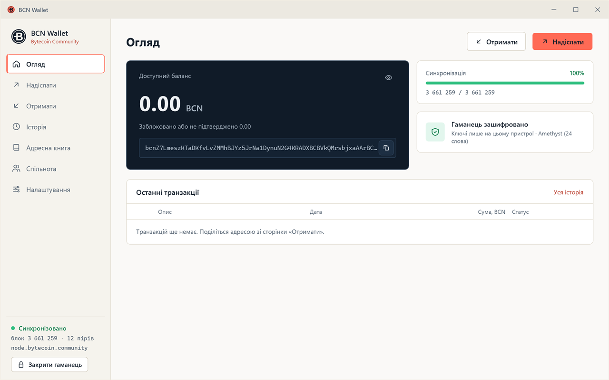

# BCN Wallet para Windows

[English](README.md) · [Українська](README.uk.md) · [Español](README.es.md) · **Português** · [Türkçe](README.tr.md) · [Bahasa Indonesia](README.id.md) · [Tiếng Việt](README.vi.md) · [中文](README.zh.md)

Uma carteira de computador para Bytecoin (BCN). Funciona **com ou sem baixar a blockchain**, guarda as suas chaves no seu computador, tem temas escuro e claro e interface em oito idiomas. Vem como instalador e como zip portátil.

Este é um projeto independente da comunidade Bytecoin, sem ligação com os fundadores do Bytecoin nem com a bcndev.


## Download

Em [bytecoin.community](https://bytecoin.community/#downloads):

- `BCNWallet-<versão>-setup.exe`: instala só para o seu usuário (sem direitos de administrador) em `%LOCALAPPDATA%\Programs\BCN Wallet`, cria atalhos no menu Iniciar e na área de trabalho e uma entrada em Configurações → Aplicativos para desinstalar. Carteiras e configurações ficam em `%APPDATA%\BCN Wallet`; instalar, atualizar e desinstalar nunca mexem nelas.
- `BCNWallet-<versão>-win-portable.zip`: descompacte em qualquer lugar, até num pendrive, e rode `BCNWallet.exe`. Tudo (configurações, arquivos da carteira, cache e, no modo nó completo, a blockchain) fica na pasta `data` ao lado do programa. **Essa pasta guarda as suas carteiras:** elas se perdem se você apagar ou substituir a pasta, descompactar uma atualização por cima ou abrir o programa direto do zip. Anote antes as 24 palavras, não mantenha a pasta em Downloads, em pastas temporárias nem em pastas sincronizadas com a nuvem, e faça cópia dela com a carteira fechada.

Ambos trazem `walletd.exe` e `bytecoind.exe` 3.5.1 da [versão oficial do Bytecoin](https://github.com/bcndev/bytecoin/releases/tag/v3.5.1), sem alterações. `SHA256SUMS` lista as somas de verificação dos dois arquivos. Não é preciso instalar mais nada: o .NET Framework 4.8 já vem no Windows 10 e 11.

## Duas formas de conectar

| | Sem a blockchain (padrão) | Nó completo |
| --- | --- | --- |
| Como | o walletd conversa com um bytecoind remoto: [node.bytecoin.community](https://node.bytecoin.community/) ou qualquer nó que você informar | a carteira inicia o próprio `bytecoind` e o walletd conversa com ele em `127.0.0.1` |
| Disco | cerca de 100 MB | cerca de 45 GB |
| Pronto | em minutos | após a primeira sincronização: de muitas horas a alguns dias |
| Privacidade | chaves, arquivo da carteira e varredura ficam no seu PC; o nó vê quais blocos você baixa e quais transações envia | nada sai do seu PC além do tráfego P2P normal |

Você escolhe na tela inicial e pode mudar a qualquer momento em Configurações → Conexão. Se já houver um `bytecoind` respondendo em `127.0.0.1:8081` (por exemplo, o seu próprio nó), a carteira usa esse em vez de iniciar outro. Se a carteira oficial do Bytecoin já baixou a blockchain em `%APPDATA%\bytecoin`, o modo nó completo oferece essa pasta e só os blocos que faltam são baixados. Antes de trocar, a carteira verifica o espaço livre e se o disco é SSD ou HDD, e informa quanto a primeira sincronização pode levar (num HDD, uma semana ou mais).

### Nós

Configurações → Conexão lista os nós públicos com JSON-RPC aberto: o nó da comunidade `node.bytecoin.community` e os dois nós oficiais da bcndev `node01/node02.bytecoin.org:8091`. Você pode adicionar os seus (`host:porta`, `http://…`, `https://…`). «Verificar nós» mostra para cada um o tempo de resposta, a altura e se está na mesma cadeia que os outros (compara-se o hash de um bloco abaixo do topo mais baixo; um nó com outro hash é marcado como «outra cadeia — não usar»).

**Automático** (padrão) escolhe ao acaso entre os nós saudáveis que não são muito mais lentos que o mais rápido, para que as carteiras se espalhem por vários nós em vez de sobrecarregar um só, e muda para outro nó se o atual parar de responder por 90 segundos.

### Uma blockchain que você já tem

O modo nó completo precisa de uma *pasta de dados* do bytecoind, a que contém a subpasta `blockchain`. A carteira oficial a guarda em `%APPDATA%\bytecoin`, e esta carteira oferece essa pasta automaticamente. Você também pode copiar a pasta de outro PC (pare antes o bytecoind dele) e escolhê-la em Configurações → Conexão. Mantenha-a num SSD com NTFS, fora de pastas sincronizadas pelo OneDrive ou Dropbox.

«Verificar a blockchain» compara os hashes de blocos do seu nó em alturas espalhadas por toda a cadeia (os primeiros blocos, a cada 500 000 blocos e perto do topo) com todos os nós públicos saudáveis. Hashes iguais significam que o seu banco de dados está na mesma cadeia que a rede; depois disso o bytecoind valida sozinho cada bloco novo. O bytecoind 3.5.1 não revalida bloco a bloco um banco copiado, então, para independência total, baixe a cadeia do zero.

## O que ela faz

- Criar uma carteira (mnemônica BIP39 de 24 palavras, conferida redigitando 3 palavras), restaurar a partir das palavras com uma data opcional de «criada depois de», abrir qualquer arquivo `.wallet` e importar as chaves de uma carteira antiga (endereços que começam com `2`).
- Os outros tipos de carteira da carteira oficial: uma carteira Amethyst de hardware (Ledger/Trezor com o aplicativo Bytecoin; experimental, ainda não testada com um dispositivo) e uma carteira legacy com chaves aleatórias.
- Saldo, progresso da sincronização e transações recentes; histórico completo com busca e filtros; detalhes da transação com link para o [explorador](https://explorer.bytecoin.community).
- Envio com níveis de taxa (econômica / normal / rápida, com base na taxa recomendada pelo nó), nível de anonimato 0–50 (tamanho do anel − 1, padrão 6 como no walletd), «enviar tudo», payment ID opcional para corretoras e tela de confirmação com a taxa exata.
- Prova de pagamento (sendproof): crie uma para uma transação enviada ou confira uma prova que lhe deram; útil em negócios P2P e com corretoras.
- Receber: endereço com QR code (opcionalmente com valor) e endereços extras com rótulos em carteiras Amethyst.
- Catálogo de endereços (guardado localmente).
- Mostrar as 24 palavras (ou as chaves de uma carteira antiga) e copiá-las inteiras: a área de transferência é limpa após 60 segundos; trocar a senha; exportar uma cópia somente leitura.
- Página da comunidade: link para o [BCN Miner](https://github.com/bytecoinBCN-community/bcn-miner) com «copiar meu endereço para minerar» num clique, o pool da comunidade, o site, o explorador, a carteira web, o Telegram e o GitHub.
- Ícone na bandeja com avisos de pagamentos recebidos, iniciar com o Windows e ocultar valores.


## Segurança

- O walletd criptografa o arquivo da carteira com a sua senha. Senhas e a mnemônica são passadas ao walletd pela entrada padrão (UTF-8), nunca pela linha de comando, e a interface nunca as grava em disco. Enquanto a carteira está aberta, a senha fica na memória do programa para que ele possa reconectar depois que você mudar as configurações do nó; «Fechar carteira» a apaga.
- O walletd escuta só em `127.0.0.1`, numa porta livre aleatória, com uma nova senha HTTP aleatória a cada início.
- O walletd e o bytecoind rodam dentro de um Job Object: se a carteira fechar ou travar, eles param junto.
- A interface nunca envia as suas chaves a lugar algum. No modo sem blockchain, o nó remoto recebe as mesmas requisições que de qualquer carteira Bytecoin; a privacidade das transações (assinaturas em anel, endereços de uso único) é garantida pelo próprio Bytecoin.
- Se faltarem walletd ou bytecoind (compilações a partir do código-fonte), a carteira oferece baixar o arquivo oficial e só o instala se o SHA-256 bater com o valor fixado no código.

**Guarde as 24 palavras no papel.** A senha protege o arquivo; as palavras são o dinheiro.

## Idiomas

Українська, English, Español, Português, Türkçe, Bahasa Indonesia, Tiếng Việt, 中文: o mesmo conjunto de [bytecoin.community](https://bytecoin.community). Configurações → Aparência → Idioma, ou os botões da tela inicial. «Sistema» segue o idioma do Windows e, na falta dele, usa inglês.

As traduções ficam em `src/lang/<código>.txt` como linhas `chave = texto` (`{0}` é um marcador e `\n` uma quebra de linha). Para corrigir uma tradução sem recompilar, coloque `<código>.txt` numa pasta `lang` ao lado do `BCNWallet.exe`. Ucraniano e inglês foram escritos à mão; os outros idiomas foram traduzidos com ajuda de máquina, e revisões de falantes nativos são bem-vindas.



## Compilação

Basta Windows 10/11, sem ferramentas de compilação:
```
powershell -ExecutionPolicy Bypass -File .\build.ps1
```
`dist\` recebe `BCNWallet.exe`, o README e a licença. Rode `get-node.ps1` uma vez para colocar walletd e bytecoind em `node\` (eles são copiados para `dist\node`), ou deixe a carteira baixá-los no primeiro início.

```
powershell -ExecutionPolicy Bypass -File .\build.ps1 -Release
```
também cria `release\BCNWallet-<versão>-setup.exe`, `release\BCNWallet-<versão>-win-portable.zip` e `release\SHA256SUMS`.

O código é C# 5 para o compilador que vem com o .NET Framework (`csc.exe`), WPF com a interface montada em código.

## Arquivos

- `src/App.cs`: inicialização, instância única, UTF-8 na entrada padrão dos daemons, tema e idioma.
- `src/Wallet.cs`: início e parada de walletd/bytecoind, chamadas JSON-RPC (`get_status`, `get_balance`, `get_transfers`, `create_transaction`, `send_transaction`, `get_wallet_records`, `create_addresses`), exportação, troca de senha.
- `src/Node.cs`: processos dos daemons, Job Object, download dos binários oficiais com verificação SHA-256.
- `src/Rpc.cs`: cliente JSON-RPC, formatação e leitura de valores em BCN.
- `src/MainWindow.cs`, `src/Start.cs`, `src/Pages.cs`, `src/Pages2.cs`: janela, tela inicial, Visão geral, Enviar, Receber, Histórico, Catálogo, Comunidade, Configurações.
- `src/Qr.cs`: codificador de QR code.
- `src/Theme.cs`, `src/Styles.xaml`, `src/Ui.cs`: o sistema de design do canvas *Bytecoin Desktop Suite*, compartilhado com o BCN Miner.
- `setup/Setup.cs`: o instalador e desinstalador.
- `get-node.ps1`: download de walletd e bytecoind com verificação SHA-256.

## Agradecimentos

Os fluxos (como o walletd é iniciado, como os segredos são passados, quais métodos RPC são usados) seguem o [bytecoin-gui](https://github.com/bcndev/bytecoin-gui) oficial da bcndev, que esta carteira substitui por uma interface nova no estilo de bytecoin.community.

## Licença

O BCN Wallet é licenciado sob a [GNU LGPL v3.0](LICENSE) (que complementa a [GNU GPL v3.0](COPYING)). `walletd.exe` e `bytecoind.exe` são © os desenvolvedores do Bytecoin, LGPL-3.0, código-fonte em <https://github.com/bcndev/bytecoin>.
