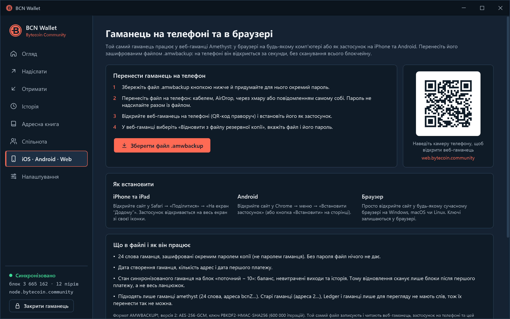

# BCN Wallet для Windows

[English](README.md) · **Українська** · [Español](README.es.md) · [Português](README.pt.md) · [Türkçe](README.tr.md) · [Bahasa Indonesia](README.id.md) · [Tiếng Việt](README.vi.md) · [中文](README.zh.md)

Настільний гаманець для Bytecoin (BCN). Працює **із завантаженням блокчейну або без нього**, тримає ключі на вашому комп'ютері, має темну й світлу теми та інтерфейс вісьмома мовами. Є інсталятор і портативний zip.

Це незалежний проєкт спільноти Bytecoin, не пов'язаний із засновниками Bytecoin чи bcndev.


## Завантаження

На сторінці [bytecoin.community](https://bytecoin.community/#downloads):

- `BCNWallet-<версія>-setup.exe` — встановлює лише для вашого користувача (без прав адміністратора) у `%LOCALAPPDATA%\Programs\BCN Wallet`, створює ярлики в меню «Пуск» і на робочому столі та запис у «Параметри → Програми» для видалення. Гаманці й налаштування зберігаються в `%APPDATA%\BCN Wallet`; встановлення, оновлення й видалення їх не чіпають.
- `BCNWallet-<версія>-win-portable.zip` — розпакуйте куди завгодно, хоч на флешку, і запустіть `BCNWallet.exe`. Усе (налаштування, файли гаманців, кеш, а в режимі повного вузла — і блокчейн) лишається в папці `data` поруч. **У цій папці ваші гаманці:** їх буде втрачено, якщо видалити чи замінити папку, розпакувати оновлення поверх неї або запустити програму прямо з zip. Спершу запишіть 24 слова, не тримайте папку в «Завантаженнях», тимчасових чи хмарних папках і робіть її копію, коли гаманець закритий.

Обидва містять `walletd.exe` і `bytecoind.exe` 3.5.1 з [офіційного релізу Bytecoin](https://github.com/bcndev/bytecoin/releases/tag/v3.5.1) без змін. У `SHA256SUMS` — контрольні суми обох файлів. Більше нічого встановлювати не треба: .NET Framework 4.8 є в Windows 10 і 11.

## Два способи підключення

| | Без блокчейну (типово) | Повний вузол |
| --- | --- | --- |
| Як | walletd звертається до віддаленого bytecoind: [node.bytecoin.community](https://node.bytecoin.community/) або будь-якого вузла, який ви вкажете | гаманець запускає власний `bytecoind`, і walletd працює з ним на `127.0.0.1` |
| Диск | близько 100 МБ | близько 45 ГБ |
| Готовність | за кілька хвилин | після першої синхронізації: від багатьох годин до кількох діб |
| Приватність | ключі, файл гаманця й сканування лишаються на ПК; вузол бачить, які блоки ви завантажуєте, і транзакції, які ви надсилаєте | з ПК нічого не виходить, крім звичайного P2P-трафіку |

Режим вибирається на стартовому екрані й змінюється будь-коли в «Налаштування → Підключення». Якщо на `127.0.0.1:8081` уже відповідає `bytecoind` (наприклад, ваш власний вузол), гаманець використає його, а не запускатиме другий. Якщо офіційний гаманець Bytecoin уже завантажив блокчейн у `%APPDATA%\bytecoin`, режим повного вузла пропонує цю папку — завантажаться лише блоки, яких бракує. Перед перемиканням гаманець перевіряє вільне місце, тип диска (SSD чи HDD) і пише, скільки може тривати перша синхронізація (на HDD — тиждень і довше).

### Вузли

У «Налаштування → Підключення» є перелік публічних вузлів із відкритим JSON-RPC: вузол спільноти `node.bytecoin.community` і два офіційні вузли bcndev `node01/node02.bytecoin.org:8091`. Можна додати свій (`host:port`, `http://…`, `https://…`). «Перевірити вузли» показує для кожного час відповіді, висоту і чи він на тому самому ланцюгу, що інші: порівнюється хеш одного блоку трохи нижче найменшої вершини. Вузол з іншим хешем позначається «інший ланцюг — не використовувати».

**Автоматично** (типово): гаманець випадково вибирає справний вузол серед тих, що не набагато повільніші за найшвидший. Так гаманці розподіляються між кількома вузлами, а не всі навалюються на один. Якщо поточний вузол не відповідає 90 секунд, гаманець перемикається на інший.

### Уже завантажений блокчейн

Повному вузлу потрібна *папка даних* bytecoind — та, у якій є підпапка `blockchain`. Офіційний гаманець тримає її в `%APPDATA%\bytecoin`, і BCN Wallet пропонує цю папку сам. Можна також скопіювати папку з іншого ПК (спершу зупинивши там bytecoind) і вибрати її в «Налаштування → Підключення». Тримайте її на SSD з NTFS, поза папками, які синхронізують OneDrive чи Dropbox.

«Перевірити блокчейн» порівнює хеші блоків вашого вузла з усіма справними публічними вузлами на висотах по всьому ланцюгу: перші блоки, кожні 500 000 блоків і біля вершини. Збіг означає, що ваша база на тому самому ланцюгу, що й мережа; далі bytecoind сам перевіряє кожен новий блок. Скопійовану базу bytecoind 3.5.1 заново поблоково не перевіряє, тож для повної незалежності завантажте ланцюг з нуля.

## Що вміє

- Створити гаманець (мнемонічна фраза BIP39 з 24 слів, перевірка введенням 3 слів), відновити зі слів з необов'язковою датою «створено не раніше», відкрити будь-який файл `.wallet`, імпортувати ключі старого гаманця (адреси на `2`).
- Баланс, стан синхронізації, останні транзакції; повна історія з пошуком і фільтрами; деталі транзакції з посиланням на [експлорер](https://explorer.bytecoin.community).
- Інші типи гаманців, як в офіційному: апаратний Amethyst (Ledger/Trezor із застосунком Bytecoin; експериментально, з пристроєм ще не перевірено) і старий гаманець із випадковими ключами.
- Надсилання з рівнями комісії (економна / звичайна / швидка — від рекомендованої вузлом), рівнем анонімності 0–50 (розмір кільця − 1, типово 6, як у walletd), «Усе», необов'язковий Payment ID для бірж, екран підтвердження з точною комісією.
- Доказ оплати (sendproof): створити для вихідної транзакції або перевірити отриманий — для P2P-угод і бірж.
- 24 слова (або ключі старого гаманця) можна скопіювати цілком — буфер обміну очищується через 60 секунд.
- Отримання: адреса з QR-кодом (за бажанням із сумою), додаткові адреси з мітками для гаманців Amethyst.
- Адресна книга (зберігається локально).
- Показати 24 слова (або ключі старого гаманця), змінити пароль, експортувати копію лише для перегляду.
- Сторінка «Спільнота»: [BCN Miner](https://github.com/bytecoinBCN-community/bcn-miner) і кнопка «Копіювати мою адресу» для майнінгу, пул спільноти, сайт, експлорер, веб-гаманець, Telegram, GitHub.
- Значок у треї зі сповіщеннями про вхідні платежі, автозапуск із Windows, приховування сум.
- Сторінка **iOS · Android · Web**: перенести гаманець у [веб-гаманець Amethyst](https://web.bytecoin.community) (браузер або застосунок на iPhone/Android) зашифрованим файлом `.amwbackup`, а також відновити такий файл тут (стартовий екран → «З файлу .amwbackup»).

### Телефон і веб: файл `.amwbackup`



Формат — той самий, що у веб-гаманця Amethyst (`docs/amwbackup-format.md` у його репозиторії), версія 2: `"AMWBACKUP1"` + сіль + nonce + AES-256-GCM, ключ PBKDF2-HMAC-SHA256 (600 000 ітерацій, Windows CNG), окремий пароль копії від 10 символів.

- **Усередині:** 24 слова, дата створення, кількість адрес і, якщо гаманець синхронізований, його стан на блок *поточний − 10*: баланс, невитрачені виходи з key image, історія та висота першого платежу. Веб-гаманець і застосунок на телефоні сканують лише від першого платежу, а не від дати створення.
- **Лише гаманці amethyst** (24 слова, адреса `bcnZ…`). Старі (`2…`), Ledger і гаманці лише для перегляду слів не мають — їх переносьте файлом `.wallet`.
- **Пароль до фрази (BIP39 passphrase):** walletd його не повідомляє, тому перед записом гаманець відтворює першу адресу лише зі слів (тимчасовий гаманець у temp-теці) і відмовляє, якщо вона інша.
- Фразу читає `walletd --export-mnemonic` (як «Показати слова»), а не JSON-RPC: секрети через RPC walletd віддає лише з `--secrets-via-api`, якого цей гаманець не вмикає.
- **Відновлення тут** розшифровує файл, перевіряє слова й створює новий `.wallet` зі скануванням від першого платежу (або блоку знімка, або дати створення) мінус доба; додаткові адреси відтворюються, а перша адреса звіряється з файлом.


## Безпека

- Файл гаманця шифрує walletd вашим паролем. Паролі й мнемонічна фраза передаються walletd через стандартний вхід (UTF-8), ніколи не в командному рядку, і GUI ніколи не пише їх на диск. Поки гаманець відкритий, пароль лишається в пам'яті програми, щоб перепідключитися після зміни налаштувань вузла; «Закрити гаманець» його стирає.
- walletd слухає лише `127.0.0.1` на вільному випадковому порту, з новим випадковим HTTP-паролем при кожному запуску.
- walletd і bytecoind працюють у Job Object: якщо гаманець закривається чи падає, вони зупиняються разом із ним.
- GUI нікуди не надсилає ваші ключі. У режимі без блокчейну віддалений вузол отримує ті самі запити, що й від будь-якого гаманця Bytecoin; приватність транзакцій (кільцеві підписи, одноразові адреси) забезпечує сам Bytecoin.
- Якщо walletd/bytecoind немає (збірка з коду), гаманець пропонує завантажити офіційний архів і встановлює його, лише якщо SHA-256 збігається зі значенням, закріпленим у коді.

**Запишіть 24 слова на папері.** Пароль захищає файл, а слова — це і є гроші.

## Мови

Українська, English, Español, Português, Türkçe, Bahasa Indonesia, Tiếng Việt, 中文 — той самий набір, що й на [bytecoin.community](https://bytecoin.community). «Налаштування → Вигляд → Мова» або кнопки на стартовому екрані. «Системна» бере мову Windows, а якщо її немає — англійську.

Переклади лежать у `src/lang/<код>.txt` рядками `ключ = текст` (`{0}` — підстановка, `\n` — новий рядок). Щоб виправити переклад без перезбирання, покладіть `<код>.txt` у папку `lang` поруч із `BCNWallet.exe`. Українську й англійську написано вручну, решту — з машинною допомогою; правки від носіїв мов вітаються.


## Збирання

Потрібна лише Windows 10/11, без інструментів збирання:
```
powershell -ExecutionPolicy Bypass -File .\build.ps1
```
У `dist\` з'являються `BCNWallet.exe`, README і LICENSE. Запустіть один раз `get-node.ps1`, щоб покласти walletd і bytecoind у `node\` (вони копіюються в `dist\node`), або дозвольте гаманцю завантажити їх під час першого запуску.

```
powershell -ExecutionPolicy Bypass -File .\build.ps1 -Release
```
додатково робить `release\BCNWallet-<версія>-setup.exe`, `release\BCNWallet-<версія>-win-portable.zip` і `release\SHA256SUMS`.

Код — C# 5 для компілятора, що входить у .NET Framework (`csc.exe`), WPF з інтерфейсом, побудованим у коді.

## Файли

- `src/App.cs` — запуск, один екземпляр, UTF-8 для stdin демонів, тема й мова.
- `src/Wallet.cs` — запуск і зупинка walletd/bytecoind, виклики JSON-RPC (`get_status`, `get_balance`, `get_transfers`, `create_transaction`, `send_transaction`, `get_wallet_records`, `create_addresses`), експорт, зміна пароля.
- `src/Node.cs` — процеси демонів, Job Object, завантаження офіційних програм із перевіркою SHA-256.
- `src/Rpc.cs` — клієнт JSON-RPC, форматування й розбір сум BCN.
- `src/MainWindow.cs`, `src/Start.cs`, `src/Pages.cs`, `src/Pages2.cs` — вікно, стартовий екран, Огляд, Надіслати, Отримати, Історія, Адресна книга, Спільнота, Налаштування.
- `src/Qr.cs` — кодувальник QR.
- `src/Theme.cs`, `src/Styles.xaml`, `src/Ui.cs` — дизайн-система з канваса *Bytecoin Desktop Suite*, спільна з BCN Miner.
- `setup/Setup.cs` — інсталятор і деінсталятор.
- `get-node.ps1` — завантаження walletd і bytecoind з перевіркою SHA-256.

## Подяка

Логіка роботи (як запускається walletd, як передаються секрети, які методи RPC використовуються) повторює офіційний [bytecoin-gui](https://github.com/bcndev/bytecoin-gui) від bcndev; цей гаманець замінює його новим інтерфейсом у стилі bytecoin.community.

## Ліцензія

BCN Wallet поширюється за [GNU LGPL v3.0](LICENSE) (доповнює [GNU GPL v3.0](COPYING)). `walletd.exe` і `bytecoind.exe` — © The Bytecoin developers, LGPL-3.0, код на <https://github.com/bcndev/bytecoin>.
