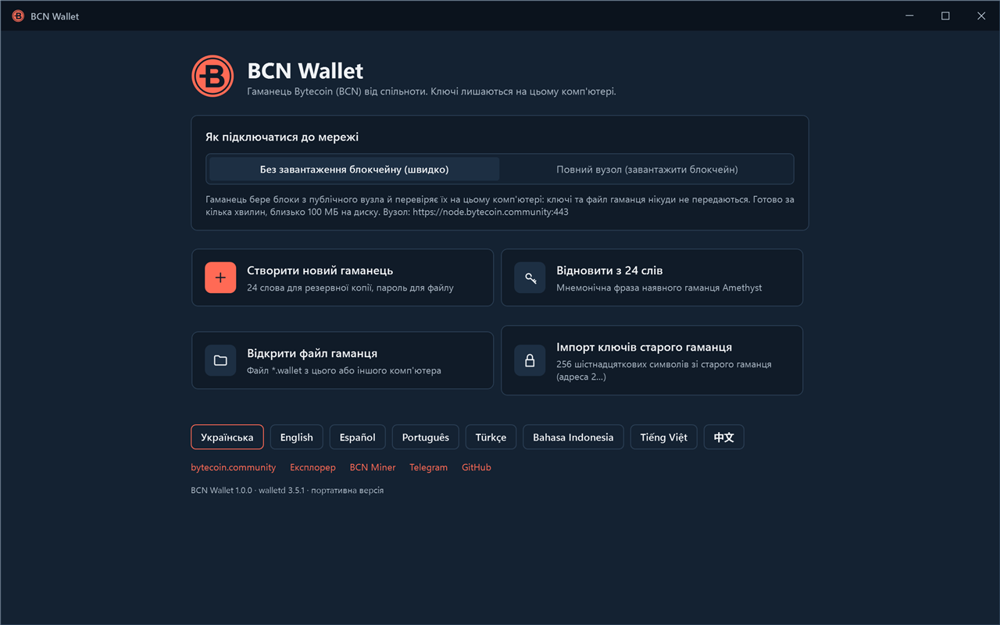

# BCN Wallet cho Windows

[English](README.md) · [Українська](README.uk.md) · [Español](README.es.md) · [Português](README.pt.md) · [Türkçe](README.tr.md) · [Bahasa Indonesia](README.id.md) · **Tiếng Việt** · [中文](README.zh.md)

Ví máy tính cho Bytecoin (BCN). Ví chạy **có hoặc không cần tải blockchain**, giữ khóa trên máy của bạn, có giao diện tối và sáng, hỗ trợ tám ngôn ngữ. Có bản cài đặt và bản zip portable.

Đây là dự án độc lập của cộng đồng Bytecoin, không liên quan đến những người sáng lập Bytecoin hay bcndev.


## Tải về

Tại [bytecoin.community](https://bytecoin.community/#downloads):

- `BCNWallet-<phiên bản>-setup.exe`: chỉ cài cho người dùng của bạn (không cần quyền quản trị) vào `%LOCALAPPDATA%\Programs\BCN Wallet`, thêm lối tắt trong menu Start và trên màn hình, và một mục trong Cài đặt → Ứng dụng để gỡ cài đặt. Ví và cài đặt được giữ trong `%APPDATA%\BCN Wallet`; cài đặt, cập nhật và gỡ bỏ đều không đụng đến chúng.
- `BCNWallet-<phiên bản>-win-portable.zip`: giải nén ở bất kỳ đâu, kể cả USB, rồi chạy `BCNWallet.exe`. Mọi thứ (cài đặt, tệp ví, bộ nhớ đệm và blockchain ở chế độ nút đầy đủ) nằm trong thư mục `data` cạnh chương trình. **Thư mục đó chứa các ví của bạn:** bạn sẽ mất chúng nếu xóa hoặc thay thư mục, giải nén bản cập nhật đè lên, hoặc chạy chương trình thẳng từ tệp zip. Hãy ghi lại 24 từ trước, đừng để thư mục trong Downloads, thư mục tạm hay thư mục đồng bộ đám mây, và sao lưu nó khi ví đã đóng.

Cả hai đều có `walletd.exe` và `bytecoind.exe` 3.5.1 từ [bản phát hành chính thức của Bytecoin](https://github.com/bcndev/bytecoin/releases/tag/v3.5.1), không sửa đổi. `SHA256SUMS` liệt kê tổng kiểm tra của cả hai tệp. Không cần cài thêm gì: .NET Framework 4.8 có sẵn trong Windows 10 và 11.

## Hai cách kết nối

| | Không có blockchain (mặc định) | Nút đầy đủ |
| --- | --- | --- |
| Cách | walletd làm việc với một bytecoind từ xa: [node.bytecoin.community](https://node.bytecoin.community/) hoặc bất kỳ nút nào bạn nhập | ví tự chạy `bytecoind` riêng và walletd làm việc với nó qua `127.0.0.1` |
| Ổ đĩa | khoảng 100 MB | khoảng 45 GB |
| Sẵn sàng | trong vài phút | sau lần đồng bộ đầu tiên: từ nhiều giờ đến vài ngày |
| Riêng tư | khóa, tệp ví và việc quét nằm trên máy bạn; nút thấy bạn tải những khối nào và gửi những giao dịch nào | không có gì rời khỏi máy bạn ngoài lưu lượng P2P bình thường |

Bạn chọn ở màn hình khởi động và có thể đổi bất cứ lúc nào trong Cài đặt → Kết nối. Nếu đã có một `bytecoind` trả lời ở `127.0.0.1:8081` (ví dụ nút của chính bạn), ví sẽ dùng nó thay vì chạy thêm một cái. Nếu ví chính thức của Bytecoin đã tải blockchain vào `%APPDATA%\bytecoin`, chế độ nút đầy đủ sẽ đề xuất thư mục đó, nên chỉ những khối còn thiếu được tải. Trước khi chuyển, ví kiểm tra dung lượng trống, ổ là SSD hay HDD, và cho biết lần đồng bộ đầu có thể mất bao lâu (trên HDD là một tuần hoặc hơn).

### Các nút

Cài đặt → Kết nối liệt kê các nút công khai mở JSON-RPC: nút cộng đồng `node.bytecoin.community` và hai nút chính thức của bcndev `node01/node02.bytecoin.org:8091`. Bạn có thể thêm nút của mình (`host:port`, `http://…`, `https://…`). «Kiểm tra nút» hiển thị cho từng nút thời gian phản hồi, độ cao và nút có cùng chuỗi với các nút khác hay không (so sánh hash của một khối dưới đỉnh thấp nhất; nút có hash khác được đánh dấu «chuỗi khác — đừng dùng»).

**Tự động** (mặc định) chọn ngẫu nhiên trong số các nút khỏe không chậm hơn nhiều so với nút nhanh nhất, để các ví phân tán trên nhiều nút thay vì dồn vào một nút, và chuyển sang nút khác khi nút hiện tại không trả lời trong 90 giây.

### Blockchain bạn đã có

Chế độ nút đầy đủ cần một *thư mục dữ liệu* của bytecoind, tức thư mục chứa thư mục con `blockchain`. Ví chính thức giữ nó trong `%APPDATA%\bytecoin`, và ví này tự động đề xuất thư mục đó. Bạn cũng có thể sao chép thư mục từ máy khác (hãy dừng bytecoind ở đó trước) và chọn nó trong Cài đặt → Kết nối. Hãy để nó trên SSD định dạng NTFS, ngoài các thư mục được OneDrive/Dropbox đồng bộ.

«Xác minh blockchain» so sánh hash khối của nút bạn tại các độ cao trải đều trên toàn chuỗi (các khối đầu, cứ mỗi 500 000 khối, và gần đỉnh) với mọi nút công khai khỏe. Hash trùng khớp nghĩa là cơ sở dữ liệu của bạn nằm cùng chuỗi với mạng; sau đó bytecoind tự xác thực từng khối mới. bytecoind 3.5.1 không xác thực lại từng khối của cơ sở dữ liệu sao chép, vì vậy để hoàn toàn độc lập hãy tải chuỗi từ đầu.

## Tính năng

- Tạo ví (cụm từ BIP39 24 từ, được kiểm tra bằng cách gõ lại 3 từ), khôi phục từ các từ với ngày «tạo sau» tùy chọn, mở bất kỳ tệp `.wallet` nào, nhập khóa của ví cũ (địa chỉ bắt đầu bằng `2`).
- Các loại ví khác của ví chính thức: ví Amethyst phần cứng (Ledger/Trezor với ứng dụng Bytecoin; thử nghiệm, chưa được kiểm tra với thiết bị) và ví legacy với khóa ngẫu nhiên.
- Số dư, tiến độ đồng bộ, giao dịch gần đây; lịch sử đầy đủ có tìm kiếm và bộ lọc; chi tiết giao dịch có liên kết tới [trình khám phá](https://explorer.bytecoin.community).
- Gửi với các mức phí (tiết kiệm / bình thường / nhanh, dựa trên phí nút đề xuất), mức ẩn danh 0–50 (kích thước vòng − 1, mặc định 6 như trong walletd), «gửi tất cả», payment ID tùy chọn cho sàn giao dịch, màn hình xác nhận với phí chính xác.
- Bằng chứng thanh toán (sendproof): tạo cho một giao dịch gửi đi, hoặc kiểm tra bằng chứng người khác đưa cho bạn; hữu ích cho giao dịch P2P và sàn.
- Nhận: địa chỉ kèm mã QR (có thể kèm số tiền), các địa chỉ phụ có nhãn cho ví Amethyst.
- Sổ địa chỉ (lưu cục bộ).
- Hiển thị 24 từ (hoặc khóa của ví cũ) và sao chép toàn bộ: bộ nhớ tạm được xóa sau 60 giây; đổi mật khẩu; xuất bản sao chỉ xem.
- Trang cộng đồng: liên kết tới [BCN Miner](https://github.com/bytecoinBCN-community/bcn-miner) với nút «sao chép địa chỉ của tôi để đào» một chạm, pool cộng đồng, trang web, trình khám phá, ví web, Telegram và GitHub.
- Biểu tượng khay hệ thống với thông báo khoản nhận, khởi động cùng Windows, ẩn số tiền.



## Bảo mật

- walletd mã hóa tệp ví bằng mật khẩu của bạn. Mật khẩu và cụm từ được chuyển cho walletd qua đầu vào chuẩn (UTF-8), không bao giờ qua dòng lệnh, và giao diện không bao giờ ghi chúng ra đĩa. Khi ví đang mở, mật khẩu được giữ trong bộ nhớ chương trình để có thể kết nối lại sau khi bạn đổi cài đặt nút; «Đóng ví» sẽ xóa nó.
- walletd chỉ lắng nghe trên `127.0.0.1`, ở một cổng trống ngẫu nhiên, với mật khẩu HTTP ngẫu nhiên mới mỗi lần khởi động.
- walletd và bytecoind chạy trong một Job Object: nếu ví đóng hoặc gặp sự cố, chúng dừng theo.
- Giao diện không bao giờ gửi khóa của bạn đi đâu cả. Ở chế độ không có blockchain, nút từ xa nhận các yêu cầu giống như từ bất kỳ ví Bytecoin nào; quyền riêng tư giao dịch (chữ ký vòng, địa chỉ dùng một lần) do chính Bytecoin đảm bảo.
- Khi thiếu walletd/bytecoind (bản dựng từ mã nguồn), ví đề nghị tải gói chính thức và chỉ cài đặt nếu SHA-256 khớp với giá trị cố định trong mã.

**Hãy ghi 24 từ ra giấy.** Mật khẩu bảo vệ tệp; các từ chính là tiền.

## Ngôn ngữ

Українська, English, Español, Português, Türkçe, Bahasa Indonesia, Tiếng Việt, 中文: cùng bộ ngôn ngữ với [bytecoin.community](https://bytecoin.community). Cài đặt → Giao diện → Ngôn ngữ, hoặc các nút trên màn hình khởi động. «Hệ thống» theo ngôn ngữ giao diện Windows và dùng tiếng Anh nếu không có.

Bản dịch nằm trong `src/lang/<mã>.txt` dưới dạng các dòng `khóa = văn bản` (`{0}` là chỗ giữ chỗ, `\n` là xuống dòng). Để sửa một bản dịch mà không cần biên dịch lại, đặt `<mã>.txt` vào thư mục `lang` cạnh `BCNWallet.exe`. Tiếng Ukraina và tiếng Anh được viết tay; các ngôn ngữ khác được dịch với sự hỗ trợ của máy, rất hoan nghênh người bản ngữ góp ý.


## Biên dịch

Chỉ cần Windows 10/11, không cần công cụ biên dịch:
```
powershell -ExecutionPolicy Bypass -File .\build.ps1
```
`dist\` nhận `BCNWallet.exe`, README và giấy phép. Chạy `get-node.ps1` một lần để đặt walletd và bytecoind vào `node\` (chúng được sao chép sang `dist\node`), hoặc để ví tự tải chúng ở lần chạy đầu.

```
powershell -ExecutionPolicy Bypass -File .\build.ps1 -Release
```
tạo thêm `release\BCNWallet-<phiên bản>-setup.exe`, `release\BCNWallet-<phiên bản>-win-portable.zip` và `release\SHA256SUMS`.

Mã nguồn là C# 5 cho trình biên dịch có sẵn trong .NET Framework (`csc.exe`), WPF với giao diện được dựng bằng mã.

## Tệp

- `src/App.cs`: khởi động, một phiên bản duy nhất, UTF-8 cho đầu vào chuẩn của các dịch vụ nền, giao diện và ngôn ngữ.
- `src/Wallet.cs`: khởi động và dừng walletd/bytecoind, các lệnh JSON-RPC (`get_status`, `get_balance`, `get_transfers`, `create_transaction`, `send_transaction`, `get_wallet_records`, `create_addresses`), xuất, đổi mật khẩu.
- `src/Node.cs`: tiến trình dịch vụ nền, Job Object, tải các tệp nhị phân chính thức có kiểm tra SHA-256.
- `src/Rpc.cs`: máy khách JSON-RPC, định dạng và đọc số tiền BCN.
- `src/MainWindow.cs`, `src/Start.cs`, `src/Pages.cs`, `src/Pages2.cs`: cửa sổ, màn hình khởi động, Tổng quan, Gửi, Nhận, Lịch sử, Sổ địa chỉ, Cộng đồng, Cài đặt.
- `src/Qr.cs`: bộ mã hóa mã QR.
- `src/Theme.cs`, `src/Styles.xaml`, `src/Ui.cs`: hệ thống thiết kế từ canvas *Bytecoin Desktop Suite*, dùng chung với BCN Miner.
- `setup/Setup.cs`: trình cài đặt và gỡ cài đặt.
- `get-node.ps1`: tải walletd và bytecoind có kiểm tra SHA-256.

## Lời cảm ơn

Các luồng xử lý (cách khởi động walletd, cách chuyển dữ liệu bí mật, các phương thức RPC được dùng) theo [bytecoin-gui](https://github.com/bcndev/bytecoin-gui) chính thức của bcndev, mà ví này thay thế bằng một giao diện mới theo phong cách bytecoin.community.

## Giấy phép

BCN Wallet được cấp phép theo [GNU LGPL v3.0](LICENSE) (bổ sung cho [GNU GPL v3.0](COPYING)). `walletd.exe` và `bytecoind.exe` © các nhà phát triển Bytecoin, LGPL-3.0, mã nguồn tại <https://github.com/bcndev/bytecoin>.
